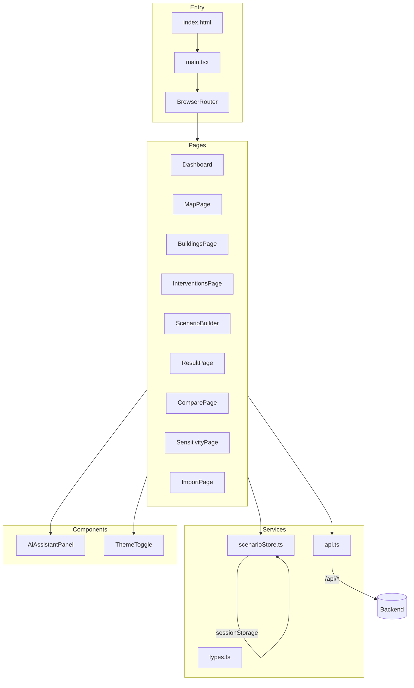
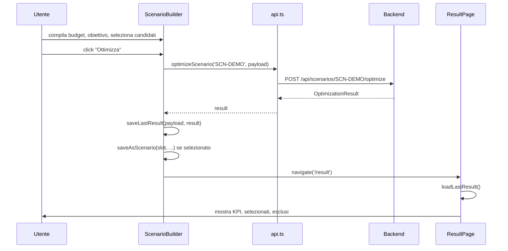
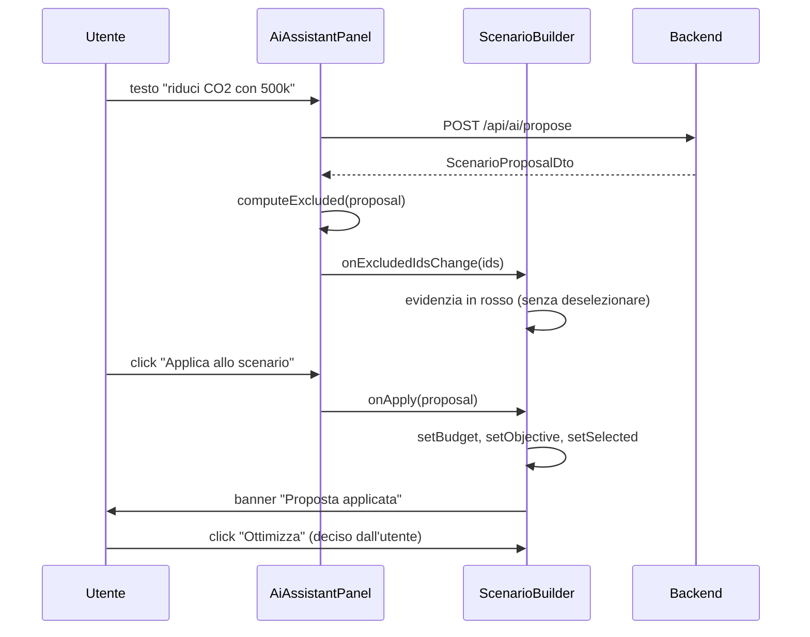
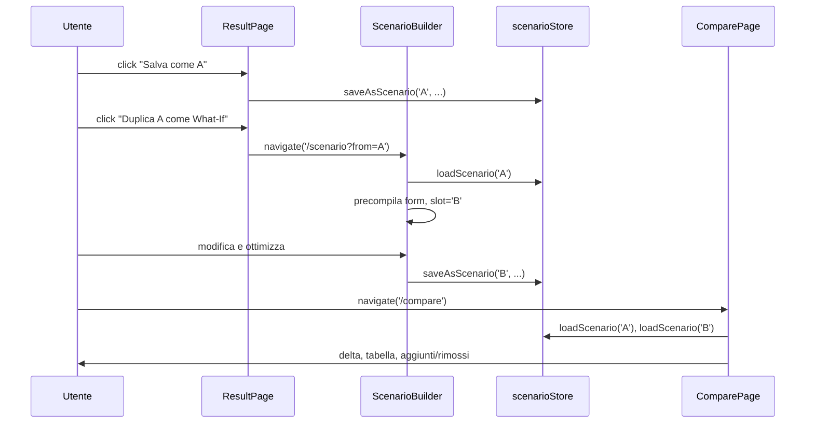

# TEPO — Frontend: guida definitiva alla revisione

**Versione:** 1.0 — 2026-10-17
**Scope:** solo frontend (`frontend/`, entry point, componenti, pagine, stili, test, config). Backend e docs oggetto di revisioni separate.
**Scopo:** permettere una revisione completa del codice AI-generated, file per file, con spiegazione di cosa fa ogni riga rilevante e perché esiste. Include i finding emersi dal confronto con il backend e con le convenzioni React/TypeScript.

---

## 0. Come usare questo documento

Ogni file è descritto con quattro sezioni fisse:

1. **Cosa fa** — funzione nel sistema.
2. **Perché esiste** — quale esigenza o problema risolve.
3. **Righe chiave** — snippet commentato riga per riga.
4. **Note di revisione** — rischi, debito, incoerenze trovate.

In coda (§13) c'è la **sintesi dei finding**, con gravità e azione consigliata.

**Ordine di lettura consigliato per la revisione:** §1 (mappa) → §4 (tipi) → §5 (API client) → §6 (store) → §3 (entry point) → §9 (pagine) → §8 (componente AI) → §7 (theme) → §10 (stili) → §11 (test) → §13 (finding).

---

## 1. Mappa del frontend

```
frontend/
├── Dockerfile                       build multi-stage (node → nginx)
├── nginx.conf                       routing SPA + proxy /api/
├── package.json                     dipendenze React 18, Vite 5, Vitest 2
├── tsconfig.json                    TypeScript strict, noEmit
├── vite.config.ts                   dev server + proxy + Vitest config
├── index.html                       entry HTML
└── src/
    ├── main.tsx                     bootstrap React + Router
    ├── types.ts                     tipi condivisi (DTO backend)
    ├── index.css                    stili legacy
    ├── services/
    │   ├── api.ts                   client fetch verso il backend
    │   └── scenarioStore.ts         persistenza su sessionStorage
    ├── components/
    │   ├── AiAssistantPanel.tsx     pannello AI con HITL
    │   └── ThemeToggle.tsx          switch tema chiaro/scuro
    ├── pages/                       9 pagine
    │   ├── Dashboard.tsx
    │   ├── MapPage.tsx
    │   ├── BuildingsPage.tsx
    │   ├── InterventionsPage.tsx
    │   ├── ScenarioBuilder.tsx
    │   ├── ResultPage.tsx
    │   ├── ComparePage.tsx
    │   ├── SensitivityPage.tsx
    │   └── ImportPage.tsx
    ├── styles/
    │   ├── tokens.css               design token CSS custom properties
    │   ├── base.css                 reset + accessibilità
    │   └── components.css           classi .tepo-*
    └── test/                        6 file, 19 test
```

Il frontend è una SPA React 18 + TypeScript + Vite 5, con React Router 6, Leaflet per la mappa, Vitest + Testing Library per i test. Non usa state management esterni (niente Redux/Zustand): lo stato è locale ai componenti e `sessionStorage` per la persistenza di sessione.



---

## 2. Infrastruttura

### 2.1 `frontend/Dockerfile`

#### Cosa fa
Build multi-stage: compila l'app con `node:24-alpine`, produce `dist/`, e lo serve con `nginx:alpine`.

#### Perché esiste
Rende il frontend avviabile senza Node locale, e con nginx che fa da reverse proxy verso il backend.

#### Righe chiave

```dockerfile
FROM node:24-alpine AS build
WORKDIR /app
COPY package*.json ./
RUN npm ci
COPY . .
RUN npm run build
```

`npm ci` (invece di `npm install`) installa le dipendenze in modo riproducibile dal `package-lock.json`. Se manca il lockfile, il build fallisce — è una scelta intenzionale: senza lockfile non c'è riproducibilità.

```dockerfile
FROM nginx:alpine
RUN apk add --no-cache curl
COPY --from=build /app/dist /usr/share/nginx/html
COPY nginx.conf /etc/nginx/conf.d/default.conf
EXPOSE 80
```

`curl` serve all'healthcheck di Docker Compose (`curl -sf http://localhost/`). `nginx.conf` sostituisce la configurazione di default.

#### Note di revisione
- L'immagine non fissa il digest: build non bit-riproducibile.
- `node:24-alpine` è LTS, ma Node 24 su Alpine è recente: verificare che tutte le dipendenze native (nessuna in questo progetto) siano disponibili.

### 2.2 `frontend/nginx.conf`

#### Cosa fa
Configura nginx per servire la SPA e fare da reverse proxy su `/api/`.

#### Perché esiste
Senza `try_files`, un refresh su `/scenario` restituirebbe 404 (il file non esiste). Senza proxy, il frontend dovrebbe chiamare `http://backend:8080` con CORS.

#### Righe chiave

```nginx
location / {
    try_files $uri /index.html;
}
```

Se il file richiesto non esiste, serve `index.html`: React Router prende il controllo e mostra la route corretta. È il pattern standard per una SPA.

```nginx
location /api/ {
    proxy_pass http://backend:8080/api/;
    proxy_set_header Host $host;
    proxy_set_header X-Real-IP $remote_addr;
}
```

`proxy_pass` inoltra `/api/*` al container backend. Il path è riscritto (`/api/foo` → `http://backend:8080/api/foo`). `Host` e `X-Real-IP` sono header utili per il debug.

#### Note di revisione
- `proxy_set_header X-Forwarded-For` manca: con più proxy a monte, l'IP originale si perde.
- Nessun `proxy_read_timeout`: il default di nginx (60s) è più che sufficiente per le chiamate al solver.

### 2.3 `frontend/package.json`

#### Cosa fa
Definisce dipendenze e script npm.

#### Perché esiste
È il contratto di build. Fissa versioni e tool.

#### Righe chiave

```json
"dependencies": {
  "leaflet": "^1.9.4",
  "react": "^18.3.1",
  "react-dom": "^18.3.1",
  "react-leaflet": "^4.2.1",
  "react-router-dom": "^6.26.2"
}
```

- `react` 18.3.1: stabile, ma frozen (l'ultimo rilascio è aprile 2024). React 19 è disponibile ma il progetto non è migrato.
- `react-leaflet` 4.2.1 richiede React 18: coerente.
- `react-router-dom` 6.26.2: la v7 è disponibile ma il progetto usa la v6.

```json
"devDependencies": {
  "vitest": "^2.1.2",
  "@testing-library/react": "^16.0.1",
  "jsdom": "^25.0.0",
  "typescript": "^5.5.4",
  "vite": "^5.4.3"
}
```

Vitest 2 + jsdom 25 + Testing Library 16 è la combinazione standard per test React con Vite. TypeScript 5.5 è recente.

```json
"scripts": {
  "dev": "vite",
  "build": "tsc && vite build",
  "preview": "vite preview",
  "test": "vitest run",
  "test:watch": "vitest"
}
```

`build` esegue `tsc` (type-check) **prima** di `vite build`: un errore di tipo blocca il build. `test` esegue i test una volta e termina; `test:watch` è per lo sviluppo.

#### Note di revisione
- React 18 frozen: rischio pratico basso ma documentato in `docs/audit-report.md`.
- Nessun `npm audit` script: le vulnerabilità transitive sono documentate ma non monitorate automaticamente.

### 2.4 `frontend/tsconfig.json`

#### Cosa fa
Configura TypeScript: target ES2022, moduli ESNext, JSX react-jsx, strict mode.

#### Perché esiste
Senza `strict`, TypeScript non segnala `null`/`undefined` impliciti. Con `strict`, i bug di nullità emergono a compile-time.

#### Righe chiave

```json
{
  "compilerOptions": {
    "target": "ES2022",
    "lib": ["ES2022", "DOM", "DOM.Iterable"],
    "module": "ESNext",
    "moduleResolution": "bundler",
    "jsx": "react-jsx",
    "strict": true,
    "esModuleInterop": true,
    "skipLibCheck": true,
    "noEmit": true,
    "types": ["vite/client", "vitest/globals"]
  },
  "include": ["src"]
}
```

- `jsx: "react-jsx"` abilita il nuovo transform JSX (React 17+), che non richiede `import React` in ogni file. Tuttavia i file lo importano comunque: ridondante ma innocuo.
- `strict: true` attiva `noImplicitAny`, `strictNullChecks`, `strictFunctionTypes`, ecc.
- `noEmit: true` perché il build lo fa Vite; `tsc` serve solo per il type-check.
- `types: ["vite/client", "vitest/globals"]` abilita i tipi di Vite e i globali di Vitest (`describe`, `it`, `expect`).

#### Note di revisione
- `include: ["src"]` esclude `vite.config.ts`: il file di config non è type-checked. È una scelta comune ma non ottimale.
- `skipLibCheck: true` salta il type-check delle `.d.ts`: velocizza ma può nascondere incompatibilità tra librerie.

### 2.5 `frontend/vite.config.ts`

#### Cosa fa
Configura il dev server (porta 5173, proxy `/api`), il plugin React e la configurazione di Vitest.

#### Perché esiste
Senza proxy, il dev server restituirebbe 404 su `/api/*` (non è lui a servire il backend). Senza `vitest` block, i test non girerebbero con la configurazione giusta.

#### Righe chiave

```ts
export default defineConfig({
  plugins: [react()],
  server: {
    port: 5173,
    proxy: {
      '/api': 'http://localhost:8080'
    }
  },
  test: {
    environment: 'jsdom',
    globals: true,
    setupFiles: ['./src/test/setup.ts'],
    css: false,
    include: ['src/**/*.{test,spec}.{ts,tsx}']
  }
});
```

- `proxy` inoltra `/api/*` a `http://localhost:8080` in sviluppo (il backend locale).
- `environment: 'jsdom'` simula il DOM nei test.
- `globals: true` abilita `describe`/`it`/`expect` senza import.
- `setupFiles` carica `@testing-library/jest-dom/vitest` per i matcher custom (`toBeInTheDocument`, ecc.).
- `css: false` evita di processare i CSS nei test (più veloce).

#### Note di revisione
- Il file importa da `vitest/config` e non da `vite`: è il pattern corretto per unire le due configurazioni.
- Il proxy non ha `changeOrigin: true`: funziona con `localhost`, potrebbe non funzionare con host virtuali.

### 2.6 `frontend/index.html`

#### Cosa fa
Documento HTML minimale con `<div id="root">` e lo script module che carica `main.tsx`.

#### Perché esiste
È il punto di ingresso della SPA.

#### Righe chiave

```html
<!doctype html>
<html lang="it">
  <head>
    <meta charset="UTF-8" />
    <title>TEPO — Trento Energy Portfolio Optimizer</title>
  </head>
  <body>
    <div id="root"></div>
    <script type="module" src="/src/main.tsx"></script>
  </body>
</html>
```

`lang="it"` è corretto per l'accessibilità. Manca `<meta name="viewport">` per il responsive: su mobile il layout non è ottimizzato (accettabile per una demo desktop).

#### Note di revisione
- Nessun `<meta name="description">`: SEO non è un obiettivo, ma il meta manca anche per i social preview.
- Nessun favicon: il browser mostra l'icona di default.

---

## 3. `src/main.tsx` — entry point

### Cosa fa
Bootstrap React: monta `<App />` in `#root`, configura `BrowserRouter`, definisce le route, importa gli stili.

### Perché esiste
È il punto in cui l'applicazione prende vita. Le route sono dichiarate qui e i componenti pagina vengono caricati in base all'URL.

### Righe chiave

```tsx
import React from 'react';
import ReactDOM from 'react-dom/client';
import { BrowserRouter, Routes, Route, Link } from 'react-router-dom';
import Dashboard from './pages/Dashboard';
// ... altre pagine
import ThemeToggle from './components/ThemeToggle';
import './styles/tokens.css';
import './styles/base.css';
import './styles/components.css';
import './index.css';
```

L'ordine di import degli stili è significativo: `tokens.css` definisce le variabili, `base.css` e `components.css` le usano, `index.css` contiene override legacy. Se `index.css` venisse prima, i token sarebbero sovrascritti.

```tsx
function App() {
  return (
    <BrowserRouter>
      <header className="topbar">
        <div className="brand">
          <strong>TEPO</strong>
          <span>Trento Energy Portfolio Optimizer</span>
        </div>
        <nav>
          <Link to="/">Dashboard</Link>
          <Link to="/map">Mappa</Link>
          {/* ... */}
        </nav>
        <ThemeToggle />
        <div className="demo-badge">DEMO — dati sintetici</div>
      </header>
      <main>
        <Routes>
          <Route path="/" element={<Dashboard />} />
          {/* ... */}
        </Routes>
      </main>
    </BrowserRouter>
  );
}
```

La topbar contiene brand, navigazione, toggle tema e badge DEMO. Il badge è sempre visibile: requisito NFR-07 (trasparenza sulla natura sintetica del dataset).

```tsx
ReactDOM.createRoot(document.getElementById('root')!).render(
  <React.StrictMode>
    <App />
  </React.StrictMode>
);
```

`StrictMode` esegue i componenti due volte in sviluppo: aiuta a trovare effetti collaterali non idempotenti. In produzione non ha effetto.

### Note di revisione
- `import React from 'react'` è ridondante con `jsx: "react-jsx"` ma innocuo. Rimuoverlo in tutti i file sarebbe una pulizia.
- La navigazione non ha `NavLink` con stato attivo: l'utente non sa su quale pagina si trova. Miglioramento UX, non bug.
- Il badge "DEMO" è hardcoded: se un giorno il dataset diventasse reale, il badge sarebbe fuorviante. Dovrebbe essere condizionato a `DataProvenance`.
- `document.getElementById('root')!` usa il non-null assertion: se `index.html` venisse modificato e il div sparisse, si avrebbe un errore a runtime invece di un errore di tipo.

---

## 4. `src/types.ts` — contratto con il backend

### Cosa fa
Definisce i tipi TypeScript che specchiano i DTO del backend.

### Perché esiste
Senza tipi condivisi, ogni componente ridefinirebbe le forme dei dati. Con i tipi, un errore di campo viene segnalato dal compilatore.

### Righe chiave

```ts
export type Building = {
  id: string;
  name: string;
  address: string;
  municipality: string;
  latitude: number;
  longitude: number;
  buildingType: string;
  surfaceM2: number;
  provenance: string;
};
```

Specchia `Building.java`. `surfaceM2` è `number` (non `number | null`), ma nel backend è `Double`: se il backend restituisse `null`, il tipo mentirebbe. Nel dataset demo non succede.

```ts
export type InterventionOption = {
  id: string;
  buildingId: string;
  interventionTypeId: string;
  name: string;
  investmentCostCents: number;
  annualEnergySavingScaled: number;
  annualEconomicSavingCents: number;
  annualCo2ReductionScaled: number;
  provenance: string;
};
```

`investmentCostCents` è `number`: JavaScript usa `number` per i `long` Java fino a 2^53, sufficiente per i centesimi del progetto.

```ts
export type OptimizationResult = {
  runId: string;
  problemHash: string;
  selectedOptionsId: string[];
  excludedOptionsId: string[];
  totalInvestmentCents: number;
  remainingBudgetCents: number;
  objectiveValue: number;
  totalEnergySavingScaled: number;
  totalEconomicSavingCents: number;
  totalCo2ReductionScaled: number;
  solverStatus: string;
  optimalityProven: boolean;
  canonicalTieBreakCompleted: boolean;
  explanations: Explanation[];
};
```

Specchia `OptimizationResult.java`. `solverStatus` è `string`, non un union type (`'OPTIMAL' | 'FEASIBLE' | ...`): perde la type safety sui valori. Migliorabile.

```ts
export type ScenarioProposalSource = 'RULE_BASED' | 'LLM' | 'LLM_FALLBACK_RULE_BASED';

export type ScenarioProposalDto = {
  budgetCents: number;
  objective: string;
  candidateOptionIds: string[];
  explanation: string;
  source: ScenarioProposalSource;
  missingInformation: string[];
  warnings: string[];
  requiresHumanReview: boolean;
};
```

`source` è un union type: il compilatore impedisce di confrontarlo con valori inesistenti. `objective` è `string` (non union): incoerenza con `source`.

```ts
export type SensitivityResult = {
  objective: string;
  baseBudgetCents: number;
  minBudgetCents: number;
  maxBudgetCents: number;
  points: number;
  grid: SensitivityPoint[];
  alwaysSelected: string[];
  neverSelected: string[];
  swing: string[];
};
```

Specchia `SensitivityService.Result`.

### Note di revisione
- **Manca `InterventionType`**: `InterventionsPage.tsx` usa un tipo inline `{ id: string; name: string }[]`. Va estratto in `types.ts`.
- **`objective` è `string` ovunque**: potrebbe essere `Objective = 'ENERGY_SAVING' | 'ECONOMIC_SAVING' | 'CO2_REDUCTION'`. Il compilatore catturerebbe typo.
- **`solverStatus` è `string`**: potrebbe essere `'OPTIMAL' | 'FEASIBLE' | 'INFEASIBLE' | 'UNKNOWN' | 'MODEL_INVALID'`.
- **`surfaceM2: number`**: il backend ha `Double`, quindi può essere `null` in teoria. `number | null` sarebbe più corretto.
- **`Explanation` è definito** ma non esportato in un tipo che includa `reasonCode` come union: i reason code sono stringhe libere.

---

## 5. `src/services/api.ts` — client HTTP

### Cosa fa
Unico punto di contatto con il backend. Espone funzioni tipizzate per ogni endpoint.

### Perché esiste
Centralizza la logica di fetch, la gestione degli errori e il parsing delle risposte. I componenti non chiamano `fetch` direttamente.

### Righe chiave

```ts
const BASE = '/api';
```

Path relativo: in sviluppo il proxy di Vite lo inoltra a `http://localhost:8080`; in produzione nginx fa lo stesso. Non serve CORS.

```ts
export async function fetchBuildings(): Promise<Building[]> {
  const r = await fetch(`${BASE}/buildings`);
  if (!r.ok) throw new Error('Errore caricamento edifici');
  return r.json();
}
```

Pattern standard: fetch, check `ok`, parse JSON. Se `!ok`, lancia un errore generico (non include il body). Per gli edifici è accettabile; per endpoint che restituiscono messaggi di errore strutturati (import, ottimizzazione) il body viene incluso.

```ts
export async function optimizeScenario(
  scenarioId: string,
  payload: OptimizePayload
): Promise<OptimizationResult> {
  const r = await fetch(`${BASE}/scenarios/${scenarioId}/optimize`, {
    method: 'POST',
    headers: { 'Content-Type': 'application/json' },
    body: JSON.stringify(payload)
  });
  if (!r.ok) {
    const text = await r.text();
    throw new Error(`Errore ottimizzazione: ${text}`);
  }
  return r.json();
}
```

A differenza di `fetchBuildings`, qui il body dell'errore viene incluso: il `GlobalExceptionHandler` restituisce JSON con `message`, utile al debug.

```ts
export async function proposeWithAi(text: string): Promise<ScenarioProposalDto> {
  const r = await fetch(`${BASE}/ai/propose`, {
    method: 'POST',
    headers: { 'Content-Type': 'application/json' },
    body: JSON.stringify({ text })
  });
  if (!r.ok) {
    const body = await r.text().catch(() => '');
    throw new Error(
      body && body.length > 0 ? `Errore assistente AI: ${body}` : 'Errore assistente AI'
    );
  }
  return r.json();
}
```

`.catch(() => '')` sul `r.text()` è difensivo: se anche la lettura del body fallisce, si lancia un errore generico.

```ts
export async function runSensitivityBudget(
  scenarioId: string,
  payload: SensitivityRequest
): Promise<SensitivityResult> {
  // ...
}
```

Stesso pattern. `SensitivityRequest` ha `points?`, `minFactor?`, `maxFactor?` opzionali: il backend applica i default.

### Note di revisione
- **Nessun timeout**: se il backend non risponde, il fetch resta appeso. Un `AbortController` con timeout sarebbe più robusto.
- **Nessun retry**: un errore transitorio richiede un click manuale. Per una demo è accettabile.
- **Nessuna gestione 404 vs 500**: il client non distingue. Se il backend restituisse 404 per un edificio inesistente, il messaggio sarebbe "Errore caricamento edifici", fuorviante.
- **`OptimizePayload` è definito qui** e re-esportato: `ScenarioBuilder` e `ResultPage` lo importano da `api.ts`, non da `types.ts`. Incoerenza minore.

---

## 6. `src/services/scenarioStore.ts` — persistenza di sessione

### Cosa fa
Salva e carica scenari A/B e l'ultimo risultato su `sessionStorage`.

### Perché esiste
FR-12 (What-If): l'utente deve poter confrontare due scenari senza perdere il primo. `sessionStorage` è sufficiente per una sessione; i dati spariscono alla chiusura della tab, coerente con l'assenza di autenticazione.

### Righe chiave

```ts
export type StoredScenario = {
  id: 'A' | 'B';
  name: string;
  payload: OptimizePayload;
  result: OptimizationResult;
  createdAt: string;
};
```

Lo scenario salvato contiene sia il payload (input) sia il result (output): il confronto può mostrare entrambi.

```ts
const KEY_A = 'tepo:scenarioA';
const KEY_B = 'tepo:scenarioB';
const KEY_LAST = 'tepo:lastResult';
```

Prefisso `tepo:` per evitare collisioni con altre chiavi. Tre slot: A, B, ultimo risultato.

```ts
export function saveAsScenario(slot: 'A' | 'B', name: string, payload: OptimizePayload, result: OptimizationResult) {
  const data: StoredScenario = {
    id: slot,
    name,
    payload,
    result,
    createdAt: new Date().toISOString()
  };
  sessionStorage.setItem(slot === 'A' ? KEY_A : KEY_B, JSON.stringify(data));
}
```

`JSON.stringify` serializza tutto: se `payload` o `result` contenessero `undefined`, verrebbe perso. I DTO non hanno campi `undefined` (solo `null`), quindi è sicuro.

```ts
export function loadScenario(slot: 'A' | 'B'): StoredScenario | null {
  const raw = sessionStorage.getItem(slot === 'A' ? KEY_A : KEY_B);
  return raw ? JSON.parse(raw) : null;
}
```

`JSON.parse` può lanciare se il dato è corrotto. Non c'è try/catch: un `sessionStorage` manomesso produrrebbe un crash. Scenario improbabile ma possibile.

```ts
export function clearAll() {
  sessionStorage.removeItem(KEY_A);
  sessionStorage.removeItem(KEY_B);
  sessionStorage.removeItem(KEY_LAST);
}
```

Utile per i test e per un eventuale pulsante "reset". Attualmente non c'è un pulsante che la chiami: codice pronto ma non esposto.

### Note di revisione
- **`JSON.parse` senza try/catch**: un dato corrotto farebbe crashare il componente. Difesa minima: try/catch e ritorno `null`.
- **Nessun versioning dello schema**: se `OptimizationResult` cambiasse forma, i dati vecchi in `sessionStorage` sarebbero incompatibili. Un campo `schemaVersion` aiuterebbe.
- **`clearAll` non usata**: codice pronto per un pulsante "reset sessione" che non esiste.
- **`sessionStorage` invece di `localStorage`**: scelta corretta per una demo senza login, ma l'utente perde i dati al refresh della tab se non salva. Documentato in `docs/audit-report.md` (P9).

---

## 7. `src/components/ThemeToggle.tsx`

### Cosa fa
Pulsante che alterna tema chiaro/scuro, salva la preferenza su `localStorage` e imposta `data-theme` su `<html>`.

### Perché esiste
Il design system ha due temi (`tokens.css`). Senza un toggle, l'utente non può scegliere. Il default segue `prefers-color-scheme`.

### Righe chiave

```tsx
function getInitialTheme(): Theme {
  if (typeof window === 'undefined') return 'light';
  const stored = window.localStorage.getItem(STORAGE_KEY);
  if (stored === 'light' || stored === 'dark') return stored;
  if (window.matchMedia && window.matchMedia('(prefers-color-scheme: dark)').matches) {
    return 'dark';
  }
  return 'light';
}
```

Tre livelli: preferenza salvata > preferenza di sistema > default chiaro. `typeof window === 'undefined'` è una guardia SSR (non usata, ma innocua).

```tsx
const [theme, setTheme] = useState<Theme>(getInitialTheme);

useEffect(() => {
  document.documentElement.setAttribute('data-theme', theme);
  window.localStorage.setItem(STORAGE_KEY, theme);
}, [theme]);
```

L'effetto sincronizza il DOM e `localStorage` con lo stato. Al primo render, `data-theme` viene impostato solo dopo il mount: c'è un FOUC (flash of unstyled content) se il tema è scuro. Documentato in `docs/audit-report.md`.

```tsx
<button
  type="button"
  className="tepo-button tepo-button--inverse tepo-button--sm"
  onClick={() => setTheme(next)}
  aria-label={label}
  title={label}
  style={{ padding: 'var(--space-2)' }}
>
```

`aria-label` e `title` sono uguali: il primo per screen reader, il secondo per tooltip. `type="button"` evita submit accidentali.

```tsx
{theme === 'light' ? (
  <svg ...><path d="M21 12.79A9 9 0 1 1 11.21 3 7 7 0 0 0 21 12.79z" /></svg>
) : (
  <svg ...><circle cx="12" cy="12" r="5" />...</svg>
)}
```

Icona luna quando il tema è chiaro (clic per passare a scuro), icona sole quando è scuro. `aria-hidden="true"` nasconde le icone agli screen reader: il testo è già nell'`aria-label` del bottone.

### Note di revisione
- **FOUC dark mode**: al primo caricamento con preferenza scura, la pagina è chiara per un frame. Fix possibile: script inline in `index.html` che imposta `data-theme` prima del bundle React.
- **`typeof window === 'undefined'`**: guardia SSR non necessaria (Vite non fa SSR), ma innocua.
- **Nessun pulsante "segui sistema"**: l'utente può solo forzare chiaro o scuro, non tornare a `prefers-color-scheme`.

---

## 8. `src/components/AiAssistantPanel.tsx`

### Cosa fa
Pannello collassabile che raccoglie un testo in linguaggio naturale, chiama `POST /api/ai/propose`, mostra la proposta e permette di applicarla o rifiutarla. Evidenzia gli interventi che l'AI propone di escludere, **senza deselezionarli**.

### Perché esiste
FR-18: l'AI propone, l'utente decide. Il pannello è l'interfaccia HITL (human-in-the-loop). La separazione tra "evidenzia" e "deseleziona" è il punto critico: l'utente vede la proposta senza mutazioni silenziose.

### Righe chiave

```tsx
type Props = {
  allOptionIds: string[];
  onApply: (proposal: ScenarioProposalDto) => void;
  onExcludedIdsChange: (ids: string[]) => void;
};
```

Tre props: tutti gli ID del catalogo (per calcolare gli esclusi), callback di applicazione, callback di evidenziazione. Il componente non conosce `ScenarioBuilder` né lo store: è puro.

```tsx
const computeExcluded = (p: ScenarioProposalDto): string[] => {
  const kept = new Set(p.candidateOptionIds);
  return allOptionIds.filter((id) => !kept.has(id));
};
```

Gli esclusi proposti sono "tutti gli ID del catalogo meno quelli che l'AI propone di tenere". È una logica locale: il backend non restituisce gli esclusi, restituisce i candidati proposti.

```tsx
const submit = async () => {
  setError(null);
  setProposal(null);
  onExcludedIdsChange([]);
  setLoading(true);
  try {
    const p = await proposeWithAi(text.trim());
    setProposal(p);
    onExcludedIdsChange(computeExcluded(p));
  } catch (e: any) {
    setError(e?.message ?? 'Errore sconosciuto');
  } finally {
    setLoading(false);
  }
};
```

Al submit: resetta errori e proposta, azzera l'evidenziazione precedente, chiama l'API, mostra la proposta, comunica gli esclusi al parent. Il `finally` garantisce che `loading` torni `false` anche in errore.

```tsx
const apply = () => {
  if (!proposal) return;
  onApply(proposal);
  onExcludedIdsChange([]);
  setProposal(null);
};

const reject = () => {
  onExcludedIdsChange([]);
  setProposal(null);
};
```

`apply` invoca la callback del parent e pulisce. `reject` pulisce senza applicare. In entrambi i casi, l'evidenziazione viene rimossa.

```tsx
useEffect(() => {
  let cancelled = false;
  fetchAiStatus()
    .then((s) => {
      if (!cancelled) setStatus(s);
    })
    .catch(() => {
      if (!cancelled) setStatusError(true);
    });
  return () => {
    cancelled = true;
  };
}, []);
```

Il flag `cancelled` evita il setState dopo unmount: pattern corretto contro i warning di React.

```tsx
{proposal && (
  <article className="tepo-card tepo-card--flat" aria-label="Proposta dell'assistente">
    {/* ... */}
    {proposal.requiresHumanReview && (
      <p role="note">
        Richiede revisione umana. La proposta non verrà applicata automaticamente.
      </p>
    )}
    {/* ... */}
    <button onClick={apply}>Applica allo scenario</button>
    <button onClick={reject}>Rifiuta</button>
  </article>
)}
```

La proposta è resa come card separata, con nota esplicita sulla revisione umana e due pulsanti. Il `role="note"` segnala agli screen reader che è un'informazione contestuale.

```tsx
<span className={sourceBadgeClass(proposal.source)}>
  {sourceLabel(proposal.source)}
</span>
```

Il badge distingue `Regole locali`, `LLM`, `LLM (fallback locale)`. L'operatore sa sempre quale motore ha risposto.

### Note di revisione
- **`e: any` nel catch**: perde la type safety. `e: unknown` con un type guard sarebbe più corretto.
- **`statusError` non resettato**: se la status call fallisce una volta, il badge resta "Stato AI non disponibile" anche se la successiva andasse a buon fine. Non c'è retry automatico.
- **Il pannello non si chiude dopo apply/reject**: l'utente deve chiuderlo manualmente. Scelta UX, non bug.
- **`allOptionIds` è una prop**: il componente non sa se il catalogo è cambiato. Se il parent ricaricasse gli interventi, `computeExcluded` userebbe la lista vecchia. Accettabile per una demo.

---

## 9. Le 9 pagine

### 9.1 `Dashboard.tsx`

#### Cosa fa
Mostra KPI del catalogo (edifici, interventi, investimento totale) e, se presente, l'ultimo risultato con link a `/result` e `/compare`.

#### Perché esiste
È la landing page. Comunica il principio architetturale e dà accesso rapido alle azioni principali.

#### Righe chiave

```tsx
useEffect(() => {
  Promise.all([fetchBuildings(), fetchInterventions()])
    .then(([b, o]) => { setBuildings(b); setOptions(o); })
    .catch((e) => setError(e.message));
  const last = loadLastResult();
  if (last) setLastResult(last.result);
}, []);
```

`Promise.all` carica edifici e interventi in parallelo. Se una delle due fallisce, il `.catch` mostra l'errore. `loadLastResult` è sincrono: legge da `sessionStorage`.

```tsx
{!lastResult && (
  <section className="tepo-card">
    <h2 className="tepo-card__title">Crea uno scenario per iniziare</h2>
    {/* ... link a /scenario ... */}
  </section>
)}
```

Empty state: se non c'è un risultato salvato, invita a creare uno scenario. Se c'è, mostra i KPI.

```tsx
const totalInvestment = options.reduce((s, o) => s + o.investmentCostCents, 0) / 100;
```

Somma dei costi in centesimi, divisa per 100 per mostrare EUR. Per 26 opzioni è trascurabile.

#### Note di revisione
- **`error` non gestisce 404 vs 500**: qualsiasi errore diventa "Backend non raggiungibile".
- **KPI "Investimento catalogo"**: non è chiaro se include tutti gli interventi o solo i candidati. Dovrebbe essere etichettato meglio.
- **Nessun refresh manuale**: se l'utente salva uno scenario in un'altra tab, la dashboard non si aggiorna fino al reload.

### 9.2 `BuildingsPage.tsx`

#### Cosa fa
Tabella degli edifici con ricerca, filtro per tipo e ordinamento per colonna.

#### Perché esiste
FR-01: consultazione del catalogo edifici.

#### Righe chiave

```tsx
const filtered = useMemo(() => {
  const filteredList = buildings.filter((b) => {
    if (typeFilter && b.buildingType !== typeFilter) return false;
    if (query) {
      const q = query.toLowerCase();
      const hay = `${b.id} ${b.name} ${b.address ?? ''}`.toLowerCase();
      if (!hay.includes(q)) return false;
    }
    return true;
  });

  const sorted = [...filteredList].sort((a, b) => {
    const va = (a as any)[sortKey];
    const vb = (b as any)[sortKey];
    if (va == null && vb == null) return 0;
    if (va == null) return 1;
    if (vb == null) return -1;
    if (typeof va === 'number' && typeof vb === 'number') return va - vb;
    return String(va).localeCompare(String(vb));
  });

  return sortAsc ? sorted : sorted.reverse();
}, [buildings, query, typeFilter, sortKey, sortAsc]);
```

`useMemo` evita di ricalcolare a ogni render. Il sort è generico: gestisce `null`, numeri e stringhe. `(a as any)[sortKey]` è un cast che perde la type safety: un `Record<SortKey, ...>` sarebbe più corretto.

```tsx
const toggleSort = (key: SortKey) => {
  if (key === sortKey) setSortAsc(!sortAsc);
  else { setSortKey(key); setSortAsc(true); }
};
```

Click sulla stessa colonna inverte l'ordine; click su una colonna diversa imposta ascendente.

#### Note di revisione
- **`(a as any)[sortKey]`**: cast che bypassa TypeScript. Migliorabile con un accessor tipizzato.
- **`sorted.reverse()` muta l'array**: `sorted` è già una copia (`[...filteredList]`), quindi è sicuro, ma è un pattern che può ingannare.
- **Nessuna paginazione**: con 10 edifici è ok, con 1000 sarebbe un problema.

### 9.3 `InterventionsPage.tsx`

#### Cosa fa
Tabella degli interventi con sei filtri (ricerca, edificio, tipo, costo min/max, stato nello scenario).

#### Perché esiste
FR-03: consultazione delle opzioni con stato rispetto all'ultimo scenario.

#### Righe chiave

```tsx
const statusOf = (id: string): StatusFilter => {
  if (!result) return 'NOT_EVALUATED';
  if (result.selectedOptionsId.includes(id)) return 'SELECTED';
  if (result.excludedOptionsId.includes(id)) return 'EXCLUDED';
  return 'NOT_EVALUATED';
};
```

Lo stato deriva dall'ultimo risultato salvato: `selected`, `excluded` o `not_evaluated`. Se non c'è risultato, tutti sono `NOT_EVALUATED`.

```tsx
useEffect(() => {
  fetchInterventions().then(setOptions);
  fetchBuildings().then(setBuildings);
  fetch('/api/intervention-types')
    .then((r) => r.json())
    .then(setTypes)
    .catch(() => setTypes([]));
  const last = loadLastResult();
  if (last) setResult(last.result);
}, []);
```

Tre fetch in parallelo (non con `Promise.all`, ma con tre chiamate separate). Se una fallisce, le altre continuano. `types` è `{ id: string; name: string }[]`: tipo inline, non in `types.ts`.

```tsx
const filtered = useMemo(() => {
  return options.filter((o) => {
    if (query) {
      const q = query.toLowerCase();
      const haystack = `${o.id} ${o.name} ${buildingName(o.buildingId)} ${typeName(o.interventionTypeId)}`.toLowerCase();
      if (!haystack.includes(q)) return false;
    }
    // ... altri filtri
    if (statusFilter !== 'ALL' && statusOf(o.id) !== statusFilter) return false;
    return true;
  });
}, [options, query, buildingFilter, typeFilter, costMin, costMax, statusFilter, result, buildings, types]);
```

La lista delle dipendenze è esaustiva: include `buildings`, `types`, `result` perché `buildingName`/`typeName`/`statusOf` li usano. Corretto.

#### Note di revisione
- **`types` inline**: dovrebbe essere in `types.ts` come `InterventionType`.
- **`fetch('/api/intervention-types')` diretto**: bypassa `api.ts`. Incoerenza con il resto del codice.
- **`(e) => setCostMin(...)` senza `onBlur`**: il filtro si applica a ogni digitazione. Per 26 opzioni è ok, per migliaia sarebbe lento.
- **Nessuna gestione errori sui tre fetch**: se falliscono, la tabella resta vuota senza messaggio.

### 9.4 `ScenarioBuilder.tsx`

#### Cosa fa
Form di configurazione scenario: budget, obiettivo, maxNumber, selezione candidati, pannello AI, pulsante "Ottimizza".

#### Perché esiste
FR-05 / FR-06 / FR-07: è il punto in cui l'utente costruisce il problema.

#### Righe chiave

```tsx
const [options, setOptions] = useState<InterventionOption[]>([]);
const [budgetEur, setBudgetEur] = useState(500000);
const [objective, setObjective] = useState('ENERGY_SAVING');
const [selected, setSelected] = useState<Set<string>>(new Set());
const [maxNumber, setMaxNumber] = useState<number | ''>('');
const [slot, setSlot] = useState<'A' | 'B' | ''>('');
```

Stato locale: nessuno store esterno. `selected` è un `Set` per lookup O(1).

```tsx
useEffect(() => {
  fetchInterventions().then((list) => {
    setOptions(list);
    setSelected(new Set(list.map((o) => o.id)));
  });

  const params = new URLSearchParams(window.location.search);
  const from = params.get('from');
  if (from === 'A' || from === 'B') {
    const s = loadScenario(from);
    if (s) {
      setBudgetEur(s.payload.budgetCents / 100);
      setObjective(s.payload.objective);
      setSelected(new Set(s.payload.candidateOptionIds));
      setMaxNumber(s.payload.maxNumber ?? '');
      setSlot(from === 'A' ? 'B' : 'A');
    }
  }
}, []);
```

Al mount: carica gli interventi e li seleziona tutti. Se l'URL ha `?from=A` o `?from=B`, carica lo scenario salvato e lo propone come nuovo (slot opposto). È il flusso "Duplica come What-If".

```tsx
const run = async () => {
  setLoading(true);
  setError(null);
  setAiAppliedBanner(false);
  try {
    const payload: OptimizePayload = {
      budgetCents: Math.round(budgetEur * 100),
      objective,
      candidateOptionIds: Array.from(selected),
      incompatibilities: [['OPT-001', 'OPT-021']],
      prerequisites: [['OPT-014', 'OPT-013']],
      maxNumber: maxNumber === '' ? null : Number(maxNumber),
      maxNumberOptionIds: maxNumber === '' ? [] : Array.from(selected)
    };
    const result = await optimizeScenario('SCN-DEMO', payload);
    saveLastResult(payload, result);
    if (slot === 'A' || slot === 'B') {
      const name = slot === 'A' ? 'Scenario A' : 'Scenario B';
      saveAsScenario(slot, name, payload, result);
    }
    navigate('/result');
  } catch (e: any) {
    setError(e.message);
  } finally {
    setLoading(false);
  }
};
```

**Punto critico (vedi §13, F-01):** `incompatibilities` e `prerequisites` sono **hardcoded**. Il backend supporta vincoli arbitrari, l'UI no. Sono i vincoli della demo (`OPT-001` incompatibile con `OPT-021`, `OPT-014` richiede `OPT-013`). Se il catalogo cambiasse, i vincoli punterebbero a ID inesistenti e il backend risponderebbe `INFEASIBLE` o ignorerebbe i vincoli.

```tsx
const applyProposal = (p: ScenarioProposalDto) => {
  setBudgetEur(Math.max(0, Math.round(p.budgetCents / 100)));
  setObjective(p.objective);
  setSelected(new Set(p.candidateOptionIds));
  setAiAppliedBanner(true);
};
```

La proposta AI applica budget, obiettivo e candidati, ma **non** `maxNumber`: il campo è segnalato nei warning ma non applicato. Scelta documentata.

#### Note di revisione
- **Vincoli hardcoded (F-01)**: il limite funzionale più visibile. L'UI non permette di configurare incompatibilità/prerequisiti.
- **`e: any` nel catch**: perde type safety.
- **`objective` è `string`**: potrebbe essere union type.
- **`setSlot(from === 'A' ? 'B' : 'A')`**: se `from` è `A`, salva in `B` e viceversa. Corretto per il flusso What-If.
- **Nessuna validazione `budgetEur`**: se l'utente inserisce un numero negativo, `Math.round(-100 * 100)` produce `-10000`. Il backend risponde 400, ma la UI non previene.

### 9.5 `ResultPage.tsx`

#### Cosa fa
Mostra il risultato dell'ottimizzazione: KPI, tabella selezionati con motivazione, lista esclusi con reason code, pulsanti per salvare come A/B e per navigare a `/compare`.

#### Perché esiste
FR-09 / FR-10 / FR-11: mostrare il piano, le metriche e le spiegazioni.

#### Righe chiave

```tsx
useEffect(() => {
  const last = loadLastResult();
  if (last) {
    setResult(last.result);
    setPayload(last.payload as OptimizePayload);
  }
  fetchInterventions().then(setOptions);
  fetchBuildings().then(setBuildings);
}, []);
```

Carica l'ultimo risultato da `sessionStorage` e i cataloghi per risolvere ID in nomi.

```tsx
const saveSlot = (slot: 'A' | 'B') => {
  if (!payload) return;
  saveAsScenario(slot, slot === 'A' ? 'Scenario A' : 'Scenario B', payload, result);
  alert(`Salvato come Scenario ${slot}`);
};
```

**`alert()`** per la conferma: funziona, ma è UX grezza. Un toast o un banner sarebbe più moderno.

```tsx
{result.excludedOptionsId.slice(0, 15).map((id) => {
  const ex = explanationFor(id);
  return (
    <li key={id}>
      <span>{id}</span>
      <span>{ex?.message ?? 'Motivazione non disponibile'}</span>
    </li>
  );
})}
```

Mostra solo i primi 15 esclusi: con 26 opzioni, se ne selezionano ~7, gli esclusi sono ~19. La lista tronca a 15 e mostra "… e altri N". Scelta di leggibilità, ma nasconde parte dell'audit trail in UI (resta via API `/api/runs`).

#### Note di revisione
- **`alert()` (F-02)**: UX grezza, sostituibile con un toast.
- **Troncamento a 15 esclusi (F-03)**: l'utente non vede tutte le motivazioni. Dovrebbe esserci un "mostra tutti".
- **`e: any` non presente**: nessun catch, perché le fetch non gestiscono errori.
- **`payload?.candidateOptionIds.length ?? '—'`**: se `payload` è null, mostra `—`. Corretto.
- **`isOptimal` deriva solo da `solverStatus === 'OPTIMAL'`**: non considera `optimalityProven`. Il badge mostra "OPTIMAL — ottimalità provata" solo se entrambi sono veri (il secondo è nel testo).

### 9.6 `ComparePage.tsx`

#### Cosa fa
Confronta Scenario A e Scenario B: delta KPI, tabella metriche, interventi aggiunti/rimossi.

#### Perché esiste
FR-13: confronto What-If.

#### Righe chiave

```tsx
const added = b.result.selectedOptionsId.filter(
  (id) => !a.result.selectedOptionsId.includes(id)
);
const removed = a.result.selectedOptionsId.filter(
  (id) => !b.result.selectedOptionsId.includes(id)
);
```

Insiemi differenza: aggiunti in B, rimossi da A. `includes` su array è O(n), con 7-18 elementi è trascurabile. Un `Set` sarebbe più efficiente.

```tsx
const delta = (va: number, vb: number) => vb - va;
const deltaClass = (d: number) => {
  if (d > 0) return 'tepo-kpi__delta tepo-kpi__delta--up';
  if (d < 0) return 'tepo-kpi__delta tepo-kpi__delta--down';
  return 'tepo-kpi__delta';
};
```

**`deltaClass` è definito ma mai usato (F-04):** le delta card non colorano il valore in base al segno. Codice morto.

```tsx
const rows: Row[] = [
  { label: 'Budget', va: fEur(a.payload.budgetCents), vb: fEur(b.payload.budgetCents) },
  { label: 'Obiettivo', va: a.payload.objective, vb: b.payload.objective },
  // ...
];
```

Tabella costruita a mano: 9 righe. Funziona, ma un array di `{ label, accessor }` sarebbe più manutenibile.

#### Note di revisione
- **`deltaClass` morto (F-04)**: rimuovere o usare.
- **`includes` invece di `Set`**: micro-ottimizzazione, non urgente.
- **Nessun controllo `a.payload.objective === b.payload.objective`**: se gli obiettivi sono diversi, il confronto è tra mele e arance. La tabella mostra l'obiettivo, ma non avverte.
- **Nessuna gestione errori sui fetch**: se `fetchInterventions` fallisce, `optionName` restituisce l'ID grezzo. Accettabile come fallback.

### 9.7 `MapPage.tsx`

#### Cosa fa
Mappa Leaflet con CircleMarker per ogni edificio, colorati per stato scenario, con sidebar che mostra gli interventi dell'edificio selezionato.

#### Perché esiste
Visualizzazione geografica del catalogo e dello stato dello scenario.

#### Righe chiave

```tsx
delete (L.Icon.Default.prototype as any)._getIconUrl;
L.Icon.Default.mergeOptions({
  iconRetinaUrl: 'https://unpkg.com/leaflet@1.9.4/dist/images/marker-icon-2x.png',
  iconUrl: 'https://unpkg.com/leaflet@1.9.4/dist/images/marker-icon.png',
  shadowUrl: 'https://unpkg.com/leaflet@1.9.4/dist/images/marker-shadow.png'
});
```

Workaround noto per Leaflet + bundler: i percorsi delle icone di default si rompono con Vite. Il fix carica le icone da unpkg (dipendenza di rete a runtime).

```tsx
const colorFor = (buildingId: string): string => {
  if (!result) return '#2e5d94';
  if (buildingHasSelected(buildingId) && !buildingHasExcluded(buildingId)) return '#2f7d5f';
  if (buildingHasSelected(buildingId) && buildingHasExcluded(buildingId)) return '#f5a623';
  if (buildingHasExcluded(buildingId)) return '#9aa5b1';
  return '#2e5d94';
};
```

**Colori hardcoded (F-05)**: `#2f7d5f`, `#f5a623`, `#9aa5b1`, `#2e5d94`. Non seguono il tema scuro né i token CSS. Dovrebbero essere `var(--color-...)`.

```tsx
<MapContainer center={[46.0679, 11.1211]} zoom={14} style={{ height: '100%', width: '100%' }}>
  <TileLayer attribution='&copy; OpenStreetMap' url="https://{s}.tile.openstreetmap.org/{z}/{x}/{y}.png" />
  {buildings.map((b) => (
    <CircleMarker
      key={b.id}
      center={[b.latitude, b.longitude]}
      radius={10}
      pathOptions={{ color: colorFor(b.id), fillColor: colorFor(b.id), fillOpacity: 0.85 }}
      eventHandlers={{ click: () => setSelected(b.id) }}
    >
      <Popup>{/* ... */}</Popup>
    </CircleMarker>
  ))}
</MapContainer>
```

Coordinate di Trento centro come default. `CircleMarker` invece di `Marker`: evita il problema delle icone e permette di colorare per stato.

```tsx
<div style={{ position: 'absolute', bottom: 'var(--space-4)', left: 'var(--space-4)', /* ... */ zIndex: 1000 }}>
  {/* legenda colori */}
</div>
```

La legenda è un overlay assoluto con `zIndex: 1000` per stare sopra la mappa Leaflet (che usa z-index 400-700).

#### Note di revisione
- **Colori hardcoded (F-05)**: non seguono il tema. Se l'utente attiva il tema scuro, i marker restano chiari.
- **Icone da unpkg**: dipendenza di rete a runtime. Se unpkg è giù, le icone si rompono. Meglio bundlare le icone.
- **`buildingHasExcluded` include tutti gli esclusi**: un edificio con 1 selezionato e 3 esclusi è colorato "selezionati + esclusi". Corretto per la semantica.
- **Nessun filtro sulla mappa**: mostra tutti gli edifici, anche quelli senza interventi. Accettabile.
- **`delete (L.Icon.Default.prototype as any)._getIconUrl`**: cast `any` necessario per il workaround, ma rompe la type safety.

### 9.8 `SensitivityPage.tsx`

#### Cosa fa
Form per lo sweep sul budget (base, obiettivo, punti, fattori), tabella risultati per punto, sezione stabilità (always/never/swing).

#### Perché esiste
FR-20: analisi di sensibilità deterministica.

#### Righe chiave

```tsx
const [options, setOptions] = useState<InterventionOption[]>([]);
const [selected, setSelected] = useState<Set<string>>(new Set());
const [budgetEur, setBudgetEur] = useState(500000);
const [objective, setObjective] = useState('ENERGY_SAVING');
const [points, setPoints] = useState(11);
const [minFactor, setMinFactor] = useState(0.5);
const [maxFactor, setMaxFactor] = useState(1.5);
```

Sei campi di stato. Default allineati con il backend (`points: 11`, `minFactor: 0.5`, `maxFactor: 1.5`).

```tsx
const run = async () => {
  setLoading(true);
  setError(null);
  setResult(null);
  try {
    const r = await runSensitivityBudget('SCN-DEMO', {
      baseBudgetCents: Math.round(budgetEur * 100),
      objective,
      candidateOptionIds: Array.from(selected),
      points,
      minFactor,
      maxFactor
    });
    setResult(r);
  } catch (e: any) {
    setError(e?.message ?? 'Errore sconosciuto');
  } finally {
    setLoading(false);
  }
};
```

Chiama l'endpoint e salva il risultato. `SCN-DEMO` è hardcoded: come per `ScenarioBuilder`, non c'è un vero scenario persistito.

```tsx
const maxSelected = useMemo(
  () => (result ? Math.max(1, ...result.grid.map((p) => p.numSelected)) : 1),
  [result]
);
```

Calcola il massimo numero di interventi selezionati in un punto, per normalizzare la barra. `Math.max(1, ...)` evita divisione per zero se tutti i punti hanno 0 selezionati.

```tsx
<span
  aria-hidden="true"
  style={{
    display: 'inline-block',
    height: 8,
    width: `${Math.max(2, (p.numSelected / maxSelected) * 120)}px`,
    background: 'var(--color-brand-accent)',
    borderRadius: 'var(--radius-full)'
  }}
/>
```

Barra proporzionale inline: `width` calcolata da `numSelected`. `Math.max(2, ...)` garantisce una barra visibile anche per 0 selezionati.

```tsx
{result.alwaysSelected.length === 0 ? (
  <p>Nessuno stabile in tutta la griglia.</p>
) : (
  <ul>{result.alwaysSelected.map((id) => <li key={id}>{id} — {optionName(id)}</li>)}</ul>
)}
```

Tre sezioni: always, swing, never. Se una è vuota, mostra un messaggio. Corretto.

#### Note di revisione
- **`SCN-DEMO` hardcoded (F-06)**: come per `ScenarioBuilder`. Non c'è modo di salvare uno scenario con un ID diverso.
- **`e: any` nel catch**: perde type safety.
- **`objective` è `string`**: potrebbe essere union type.
- **`points` non validato in UI**: se l'utente inserisce 100, il backend risponde 400. La UI non previene.
- **`minFactor >= maxFactor` non validato**: il backend risponde 400, ma la UI non avverte prima.

### 9.9 `ImportPage.tsx`

#### Cosa fa
Editor CSV con due pulsanti: "Valida" (preview senza scrittura) e "Importa" (commit). Mostra anteprima errori e risultato import.

#### Perché esiste
FR-15: import CSV in due fasi.

#### Righe chiave

```tsx
const [content, setContent] = useState('');
const [preview, setPreview] = useState<any>(null);
const [result, setResult] = useState<any>(null);
```

**`any` (F-07):** `preview` e `result` non hanno tipo. Le forme sono note (`ImportPreview`, `ImportResult`), ma non sono in `types.ts`.

```tsx
const doValidate = async () => {
  setError(null);
  setResult(null);
  setLoadingValidate(true);
  try {
    const r = await fetch('/api/imports/buildings/validate', {
      method: 'POST',
      headers: { 'Content-Type': 'application/json' },
      body: JSON.stringify({ content })
    });
    if (!r.ok) {
      const text = await r.text();
      setError(`Validazione fallita: ${text}`);
      return;
    }
    setPreview(await r.json());
  } catch (e: any) {
    setError(e.message);
  } finally {
    setLoadingValidate(false);
  }
};
```

`fetch` diretto, non tramite `api.ts`. Incoerenza con il resto del codice. Il body dell'errore viene incluso (utile).

```tsx
const doCommit = async () => {
  // ... simile a doValidate, ma chiama /commit e setta result
};
```

Stesso pattern. Il pulsante "Importa" è disabilitato finché `preview.valid === 0`: non si può importare senza una validazione positiva.

```tsx
<button
  className="tepo-button tepo-button--primary"
  onClick={doCommit}
  disabled={!preview || preview.valid === 0 || loadingCommit}
>
  {loadingCommit ? 'Importazione in corso…' : 'Importa record validi'}
</button>
```

`preview` è `any`: `preview.valid` non è type-checked. Se il backend cambiasse la forma della risposta, il pulsante resterebbe disabilitato senza errore.

#### Note di revisione
- **`any` per `preview` e `result` (F-07)**: dovrebbero essere tipizzati in `types.ts` come `ImportPreview` e `ImportResult`.
- **`fetch` diretto invece di `api.ts` (F-08)**: incoerenza. Dovrebbe essere una funzione `validateBuildingsCsv` / `commitBuildingsCsv`.
- **`e: any` nel catch**: perde type safety.
- **Nessun feedback sul numero di righe dopo import**: mostra `inserted` e `skipped`, ma non un riepilogo dettagliato (che pure il backend restituisce in `skippedDetails`).

---

## 10. Stili

### 10.1 `src/styles/tokens.css`

#### Cosa fa
Definisce le custom properties CSS per tema chiaro e scuro: colori, tipografia, spaziatura, ombre, transizioni.

#### Perché esiste
Centralizza i valori semantici. I componenti usano `var(--color-...)` invece di valori hardcoded.

#### Righe chiave

```css
:root {
  --color-bg-page: #f6f8fb;
  --color-surface: #ffffff;
  --color-text-primary: #1c2530;
  --color-brand-accent: #2e5d94;
  --space-1: 4px;
  --space-2: 8px;
  /* ... */
}
```

Tema chiaro: valori chiari, blu istituzionale. La scala di spaziatura è 4px-based.

```css
[data-theme="dark"] {
  --color-bg-page: #0f1720;
  --color-surface: #1a222e;
  --color-text-primary: #e8edf3;
  --color-brand-accent: #5d94d1;
  /* ... */
}
```

Tema scuro: superfici scure, testo chiaro, blu schiarito per contrasto. Il selettore `[data-theme="dark"]` è attivato da `ThemeToggle`.

```css
--tepo-blue: #1f3a5f;
--tepo-bg: #f6f8fb;
--tepo-text: #1c2530;
```

Token legacy preservati per compatibilità con `index.css`. Duplicazione intenzionale durante la migrazione.

#### Note di revisione
- **Duplicazione legacy/semantico**: `--tepo-blue` e `--color-brand-primary` hanno lo stesso valore. La migrazione non è completa.
- **Nessun contrast check automatico**: i contrasti sono dichiarati "WCAG AA" in `docs/design-system.md`, ma non c'è un test che lo verifichi.

### 10.2 `src/styles/base.css`

#### Cosa fa
Reset conservativo, focus visibile, `prefers-reduced-motion`, `.tepo-sr-only`, `.tepo-skip-link`.

#### Perché esiste
Fornisce le regole di accessibilità e le basi tipografiche che i componenti possono assumere.

#### Righe chiave

```css
:focus-visible {
  outline: var(--focus-ring-width) solid var(--color-focus-ring);
  outline-offset: var(--focus-ring-offset);
  border-radius: var(--radius-sm);
}
```

Focus visibile solo su `:focus-visible` (tastiera), non su click. Pattern corretto per accessibilità.

```css
@media (prefers-reduced-motion: reduce) {
  *, *::before, *::after {
    animation-duration: 0.01ms !important;
    animation-iteration-count: 1 !important;
    transition-duration: 0.01ms !important;
    scroll-behavior: auto !important;
  }
}
```

Rispetta la preferenza utente per animazioni ridotte.

```css
.tepo-sr-only {
  position: absolute;
  width: 1px;
  height: 1px;
  /* ... */
}
```

Utility per testo visibile solo agli screen reader.

#### Note di revisione
- **`.tepo-skip-link` non usato**: la classe esiste ma nessun componente la usa. Un link "salta al contenuto" sarebbe buono per accessibilità.

### 10.3 `src/styles/components.css`

#### Cosa fa
Definisce le classi `.tepo-*`: card, button, badge, form, table, KPI, layout.

#### Perché esiste
È il design system applicato ai componenti. Le pagine usano queste classi.

#### Righe chiave

```css
.tepo-card {
  background-color: var(--color-surface);
  border: 1px solid var(--color-border);
  border-radius: var(--radius-lg);
  padding: var(--space-4);
  box-shadow: var(--shadow-xs);
}
```

Card standard: superficie, bordo, raggio, padding, ombra leggera. Tutti i valori sono token.

```css
.tepo-button--primary {
  background-color: var(--color-brand-accent);
  color: var(--color-text-inverse);
  border-color: var(--color-brand-accent);
}
.tepo-button--primary:hover:not(:disabled) {
  background-color: var(--color-brand-accent-hover);
  border-color: var(--color-brand-accent-hover);
}
```

`hover:not(:disabled)` evita l'effetto hover su pulsanti disabilitati. Corretto.

```css
.tepo-input:focus,
.tepo-select:focus,
.tepo-textarea:focus {
  outline: none;
  border-color: var(--color-brand-accent);
  box-shadow: 0 0 0 3px color-mix(in srgb, var(--color-brand-accent) 25%, transparent);
}
```

`color-mix` è CSS moderno: crea un anello di focus semi-trasparente. Supportato da tutti i browser moderni.

#### Note di revisione
- **`color-mix` richiede browser recenti**: Chrome 111+, Safari 16.2+, Firefox 113+. Per una demo è ok, per un contesto enterprise andrebbe verificato.
- **`tepo-button--inverse`** è definita in fondo al file, con un commento che dice "per pulsanti su sfondo scuro/brand". Usata solo da `ThemeToggle`.

### 10.4 `src/index.css`

#### Cosa fa
Stili legacy: `.topbar`, `.brand`, `.card`, `.kpi`, `table`, `button`, `input`, `label`. Definisce anche i token legacy `--tepo-*`.

#### Perché esiste
È il CSS pre-design-system. Alcune pagine usano ancora `.card`, `.kpi` invece di `.tepo-card`, `.tepo-kpi`.

#### Righe chiave

```css
.topbar {
  display: flex;
  align-items: center;
  gap: 24px;
  padding: 12px 24px;
  background: var(--tepo-blue);
  color: white;
}
```

La topbar usa i token legacy, non i semantici. Se il tema scuro fosse attivo, la topbar resterebbe blu scuro (i token legacy non hanno una variante dark).

```css
button {
  background: var(--tepo-blue-light);
  color: white;
  border: none;
  padding: 10px 16px;
  border-radius: 6px;
  cursor: pointer;
  font-weight: 600;
}
```

**Stile globale su `button` (F-09):** qualsiasi `<button>` senza classe `.tepo-button` eredita questo stile. È un conflitto potenziale con il design system: un pulsante con classe `.tepo-button--secondary` avrebbe background trasparente, ma il selettore globale `button` ha specificità 0,0,1 mentre `.tepo-button--secondary` ha 0,1,0 — quindi vince la classe. Funziona, ma è fragile.

#### Note di revisione
- **`.topbar` non segue il tema scuro (F-10)**: usa `--tepo-blue` fisso. Con tema scuro, la topbar resta blu.
- **Selettori globali (`button`, `input`, `table`) (F-09)**: conflitto potenziale con il design system. Da migrare.
- **Doppia definizione dei token**: `--tepo-*` in `index.css` e `--color-*` in `tokens.css`. La migrazione è incompleta.

---

## 11. Test

### 11.1 `src/test/setup.ts`

#### Cosa fa
Importa `@testing-library/jest-dom/vitest` per i matcher custom.

#### Perché esiste
Senza, `expect(...).toBeInTheDocument()` non esiste.

#### Righe chiave

```ts
import '@testing-library/jest-dom/vitest';
```

Una riga. Caricato da `vite.config.ts` via `setupFiles`.

### 11.2 `src/test/AiAssistantPanel.test.tsx` — 8 test

#### Cosa fa
Testa il pannello AI: status locale/LLM/errore, proposta con warning, apply, reject, errore di rete, fallback.

#### Perché esiste
È il componente più delicato: deve garantire il contratto di non-applicazione automatica.

#### Righe chiave

```tsx
function stubFetch(handler: Stub) {
  vi.stubGlobal('fetch', vi.fn((input: any) => handler(String(input))));
}
```

`stubGlobal` sostituisce `fetch` per tutti i test del file. `afterEach` chiama `vi.unstubAllGlobals()` per ripristinare.

```tsx
it('invia la richiesta, mostra la proposta LLM e comunica gli esclusi al parent', async () => {
  // ...
  expect(onExcludedIdsChange).toHaveBeenCalledWith(['OPT-002', 'OPT-003']);
});
```

Verifica che `computeExcluded` restituisca gli ID non proposti. È il test più importante: garantisce che l'evidenziazione funzioni.

```tsx
it('Applica invoca onApply e pulisce l\'evidenziazione', async () => {
  // ...
  expect(onApply).toHaveBeenCalledTimes(1);
  const calls = onExcludedIdsChange.mock.calls;
  expect(calls[calls.length - 1][0]).toEqual([]);
});
```

Verifica che `apply` chiami la callback e azzeri l'evidenziazione.

#### Note di revisione
- **Nessun test per `requiresHumanReview`**: il campo è sempre `true`, ma non c'è un'asserzione esplicita.
- **Nessun test per il troncamento dell'input**: il backend tronca a 2000 caratteri, ma il test non lo copre.

### 11.3 `src/test/ComparePage.test.tsx` — 2 test

#### Cosa fa
Testa lo stato vuoto e la tabella di confronto con A e B salvati.

#### Righe chiave

```tsx
sessionStorage.setItem('tepo:scenarioA', JSON.stringify({ /* ... */ }));
sessionStorage.setItem('tepo:scenarioB', JSON.stringify({ /* ... */ }));
```

I test iniettano dati in `sessionStorage` prima del render. `beforeEach` chiama `sessionStorage.clear()`.

```tsx
expect(screen.getByRole('columnheader', { name: 'Scenario A' })).toBeInTheDocument();
```

Query semantica: `columnheader` è il ruolo ARIA corretto per `<th>`. Meglio di `getByText`.

#### Note di revisione
- **Nessun test per il calcolo dei delta**: `deltaClass` è morto, ma un test che verifichi i valori delle delta card sarebbe utile.

### 11.4 `src/test/Dashboard.test.tsx` — 2 test

#### Cosa fa
Testa lo stato vuoto e il principio architetturale.

#### Righe chiave

```tsx
stubFetch({
  '/api/buildings': () => [],
  '/api/interventions': () => []
});
```

Stub semplice: risponde `[]` per entrambi gli endpoint. Il test verifica che la dashboard mostri l'empty state.

#### Note di revisione
- **Nessun test per lo stato con risultato**: il KPI "Ultimo risultato" non è testato.

### 11.5 `src/test/scenarioStore.test.ts` — 3 test

#### Cosa fa
Testa salvataggio, caricamento e pulizia degli slot.

#### Righe chiave

```ts
it('salva e carica Scenario A', () => {
  saveAsScenario('A', 'Scenario A', fakePayload, fakeResult);
  const loaded = loadScenario('A');
  expect(loaded?.name).toBe('Scenario A');
  expect(loaded?.payload.budgetCents).toBe(50000000);
});
```

Test unit puro, senza DOM. Verifica il round-trip.

```ts
it('pulisce tutti gli slot', () => {
  // ...
  clearAll();
  expect(loadScenario('A')).toBeNull();
  expect(loadScenario('B')).toBeNull();
  expect(loadLastResult()).toBeNull();
});
```

Verifica che `clearAll` rimuova tutte le chiavi.

#### Note di revisione
- **Nessun test per `JSON.parse` corrotto**: il test non copre il caso in cui `sessionStorage` contenga dati invalidi.

### 11.6 `src/test/SensitivityPage.test.tsx` — 4 test

#### Cosa fa
Testa form, esecuzione, errore, disabilitazione del pulsante.

#### Righe chiave

```tsx
expect(screen.getByLabelText(/Budget base \(EUR\)/i)).toBeInTheDocument();
```

`getByLabelText` trova l'input associato alla label. Funziona perché il markup usa `<label><span>...</span><input /></label>`.

```tsx
await userEvent.click(screen.getByRole('button', { name: /Deseleziona tutti/i }));
await waitFor(() => {
  expect(screen.getByRole('button', { name: /Esegui analisi/i })).toBeDisabled();
});
```

Testa la disabilitazione: dopo "Deseleziona tutti", `selected.size` è 0 e il pulsante è disabled.

#### Note di revisione
- **Nessun test per la sezione stabilità vuota**: se `alwaysSelected` è vuoto, il messaggio "Nessuno stabile" non è testato.

---

## 12. Flussi end-to-end nel frontend

### 12.1 Costruzione scenario → ottimizzazione → risultato



### 12.2 Proposta AI → applicazione esplicita



### 12.3 Confronto What-If



---

## 13. Sintesi dei finding

| ID | Finding | Gravità | File coinvolti | Azione consigliata |
|---|---|---|---|---|
| F-01 | `ScenarioBuilder` ha vincoli demo hardcoded (`OPT-001↔OPT-021`, `OPT-014→OPT-013`) | Media | `ScenarioBuilder.tsx` | Estrarre in configurazione o permettere configurazione UI |
| F-02 | `ResultPage.saveSlot` usa `alert()` per la conferma | Bassa | `ResultPage.tsx` | Sostituire con toast/banner |
| F-03 | `ResultPage` tronca gli esclusi a 15 senza "mostra tutti" | Bassa | `ResultPage.tsx` | Aggiungere espansione |
| F-04 | `ComparePage.deltaClass` è definito ma mai usato | Bassa | `ComparePage.tsx` | Rimuovere o usare per colorare i delta |
| F-05 | `MapPage` ha colori hardcoded che non seguono il tema scuro | Bassa | `MapPage.tsx` | Usare token CSS |
| F-06 | `SensitivityPage` e `ScenarioBuilder` usano `SCN-DEMO` hardcoded | Media | `SensitivityPage.tsx`, `ScenarioBuilder.tsx` | Introdurre un vero ID scenario o documentare il limite |
| F-07 | `ImportPage` usa `any` per `preview` e `result` | Media | `ImportPage.tsx` | Tipizzare `ImportPreview` e `ImportResult` in `types.ts` |
| F-08 | `ImportPage` e `InterventionsPage` chiamano `fetch` direttamente | Bassa | `ImportPage.tsx`, `InterventionsPage.tsx` | Aggiungere funzioni in `api.ts` |
| F-09 | `index.css` ha selettori globali su `button`, `input`, `table` | Media | `index.css` | Migrare a classi `.tepo-*` |
| F-10 | `.topbar` usa token legacy, non segue il tema scuro | Bassa | `index.css`, `main.tsx` | Migrare a token semantici |
| F-11 | `types.ts` manca `InterventionType`; `objective` e `solverStatus` sono `string` | Media | `types.ts` | Aggiungere tipi e union |
| F-12 | `scenarioStore.loadScenario` non gestisce `JSON.parse` corrotto | Bassa | `scenarioStore.ts` | Aggiungere try/catch |
| F-13 | `api.ts` non ha timeout né retry | Media | `api.ts` | Aggiungere `AbortController` con timeout |
| F-14 | `ThemeToggle` produce FOUC al primo caricamento con tema scuro | Bassa | `ThemeToggle.tsx`, `index.html` | Script inline che imposta `data-theme` prima del bundle |
| F-15 | `BuildingsPage` usa `(a as any)[sortKey]` | Bassa | `BuildingsPage.tsx` | Tipizzare l'accessor |
| F-16 | `AiAssistantPanel` non resetta `statusError` | Bassa | `AiAssistantPanel.tsx` | Permettere retry della status call |
| F-17 | React 18 frozen, ma non EOL formale | Bassa | `package.json` | Pianificare migrazione a React 19 |
| F-18 | `main.tsx` importa `React` anche con `jsx: react-jsx` | Bassa | `main.tsx` e altri | Rimuovere import ridondanti |
| F-19 | Nessun test per `BuildingsPage`, `InterventionsPage`, `MapPage`, `ResultPage`, `ImportPage`, `ScenarioBuilder` | Media | `src/test/` | Aggiungere test di rendering e interazione |
| F-20 | Navigazione senza stato attivo (`NavLink` invece di `Link`) | Bassa | `main.tsx` | Miglioramento UX |

### 13.1 Priorità

**P1 — da correggere prima della consegna:**
- F-01 (vincoli hardcoded): è il limite funzionale più visibile.
- F-07 (`any` nell'import): type safety persa su un percorso critico.
- F-11 (tipi mancanti/string): type safety persa su tutto il frontend.
- F-13 (timeout API): un backend lento blocca la UI senza feedback.

**P2 — da correggere se c'è tempo:**
- F-06 (`SCN-DEMO` hardcoded)
- F-09 (selettori globali in `index.css`)
- F-19 (test mancanti)
- F-12 (`JSON.parse` non protetto)

**P3 — debito documentato, non bloccante:**
- F-02 (`alert()`)
- F-03 (troncamento esclusi)
- F-04 (`deltaClass` morto)
- F-05 (colori hardcoded mappa)
- F-08 (`fetch` diretto)
- F-10 (topbar legacy)
- F-14 (FOUC)
- F-15 (`as any` sort)
- F-16 (statusError non resettato)
- F-17 (React 18 frozen)
- F-18 (import React ridondanti)
- F-20 (NavLink)

**Positivi (nessuna azione):**
- Il pattern HITL è implementato correttamente (`requiresHumanReview`, evidenzia senza deselezionare).
- Il design system è coerente e usa token semantici.
- I test frontend coprono i percorsi critici (AI panel, sensitivity, compare).
- La separazione `services/pages/components` è pulita.

---

## 14. Checklist di revisione

Usa questa checklist per una revisione sistematica del codice AI-generated.

### 14.1 Correttezza dei tipi

- [ ] Ogni DTO backend ha un tipo TypeScript corrispondente in `types.ts`?
- [ ] `objective` è un union type, non `string`?
- [ ] `solverStatus` è un union type, non `string`?
- [ ] `InterventionType` è in `types.ts`?
- [ ] Nessun `any` in percorsi critici (import, AI, sensitivity)?
- [ ] `OptimizePayload` è in `types.ts` o in `api.ts` (coerenza)?

### 14.2 Correttezza delle chiamate API

- [ ] Ogni endpoint backend ha una funzione in `api.ts`?
- [ ] Gli errori includono il body quando è utile?
- [ ] C'è un timeout (`AbortController`)?
- [ ] I 404 sono distinti dai 500?
- [ ] Le chiamate duplicate sono centralizzate?

### 14.3 Correttezza dello stato

- [ ] Lo stato è locale dove possibile?
- [ ] `useMemo` ha dipendenze esaustive?
- [ ] `useEffect` ha cleanup (cancelled flag)?
- [ ] `sessionStorage` è protetto da `JSON.parse` corrotto?
- [ ] C'è un modo per resettare lo stato?

### 14.4 Correttezza dell'AI

- [ ] La proposta non viene applicata senza click esplicito?
- [ ] Gli esclusi proposti sono evidenziati senza deselezionare?
- [ ] Il badge del motore (`RULE_BASED`/`LLM`/`LLM_FALLBACK`) è visibile?
- [ ] `requiresHumanReview` è mostrato?
- [ ] I warning sono visibili all'utente?

### 14.5 Correttezza dell'accessibilità

- [ ] Ogni input ha una label associata?
- [ ] Ogni bottone icona ha `aria-label`?
- [ ] Il focus è visibile (`:focus-visible`)?
- [ ] `prefers-reduced-motion` è rispettato?
- [ ] I colori hanno contrasto WCAG AA?

### 14.6 Correttezza del tema

- [ ] I componenti usano token semantici (`--color-*`) e non valori hardcoded?
- [ ] Il tema scuro è supportato ovunque?
- [ ] La topbar segue il tema?
- [ ] I marker Leaflet seguono il tema?

### 14.7 Correttezza della navigazione

- [ ] Ogni route ha un componente?
- [ ] La navigazione mostra lo stato attivo?
- [ ] Il refresh su una route funziona (nginx `try_files`)?
- [ ] Il flusso What-If (`?from=A`) funziona?

---

## 15. Comandi di verifica

### 15.1 Test frontend

```bash
cd frontend
npm test -- --run
```

Atteso: `Test Files 5 passed`, `Tests 19 passed`.

### 15.2 Type-check

```bash
cd frontend
npx tsc --noEmit
```

Atteso: nessun output (nessun errore).

### 15.3 Build di produzione

```bash
cd frontend
npm run build
```

Atteso: `vite build` con `✓ built in ...`. Il `tsc` viene eseguito prima da `npm run build`.

### 15.4 Avvio dev

```bash
cd frontend
npm run dev
```

Atteso: `Local: http://localhost:5173/`. Il proxy `/api` inoltra a `http://localhost:8080`.

### 15.5 Avvio completo

```bash
docker compose up --build
```

Atteso: `tepo-frontend` healthy, apri `http://localhost:5173`.

### 15.6 Verifica tema scuro

Apri l'app, clicca il toggle in alto a destra. Verifica che:
- lo sfondo diventi scuro;
- il testo sia leggibile;
- i badge mantengano il contrasto;
- la topbar... (F-10: resta blu scuro, non cambia).

### 15.7 Verifica AI HITL

Apri `/scenario`, espandi il pannello AI, scrivi `voglio ridurre la CO2 con budget 500k`, premi "Chiedi all'assistente". Verifica che:
- la proposta appaia con badge "Regole locali" (senza API key);
- gli interventi proposti da escludere siano evidenziati in rosso ma **non deselezionati**;
- "Rifiuta" pulisca l'evidenziazione senza applicare;
- "Applica allo scenario" compili budget e obiettivo.

### 15.8 Verifica import CSV

Apri `/import`, clicca "Carica esempio", "Valida". Verifica che:
- la preview mostri 2 righe valide;
- "Importa record validi" sia abilitato;
- dopo il commit, il risultato mostri `inserted: 2`.

---

## 16. Conclusione

Il frontend TEPO è un'applicazione React + TypeScript più matura di quanto il contesto accademico richieda:

- **Separazione pulita** tra `services` (API, store), `components` (AI, tema) e `pages`.
- **Design system coerente** con token semantici e tema scuro.
- **Pattern HITL corretto**: l'AI propone, l'utente applica esplicitamente.
- **Test mirati** sui percorsi critici (AI panel, sensitivity, compare).

I problemi principali emersi dalla revisione non sono nell'architettura, ma nei **dettagli di implementazione**:

1. **Type safety persa** in punti critici (`any` nell'import, `string` invece di union type, `as any` nel sort).
2. **Vincoli demo hardcoded** in `ScenarioBuilder` (F-01): il limite funzionale più visibile.
3. **Incoerenze di chiamata API**: alcune pagine usano `api.ts`, altre `fetch` diretto.
4. **Debito visivo**: topbar e marker mappa non seguono il tema scuro, `alert()` per conferme.
5. **Test mancanti** per 6 pagine su 9.

Nessuno di questi invalida il funzionamento della demo. Sono correzioni a basso rischio che alzano la qualità percepita e la manutenibilità.

**Prossimi passi:** revisione di `docs/` (documentazione tecnica e allineamento con il codice), poi `scripts/` e root (`docker-compose.yaml`, `README.md`, `ISTRUZIONI-AVVIO.md`).
